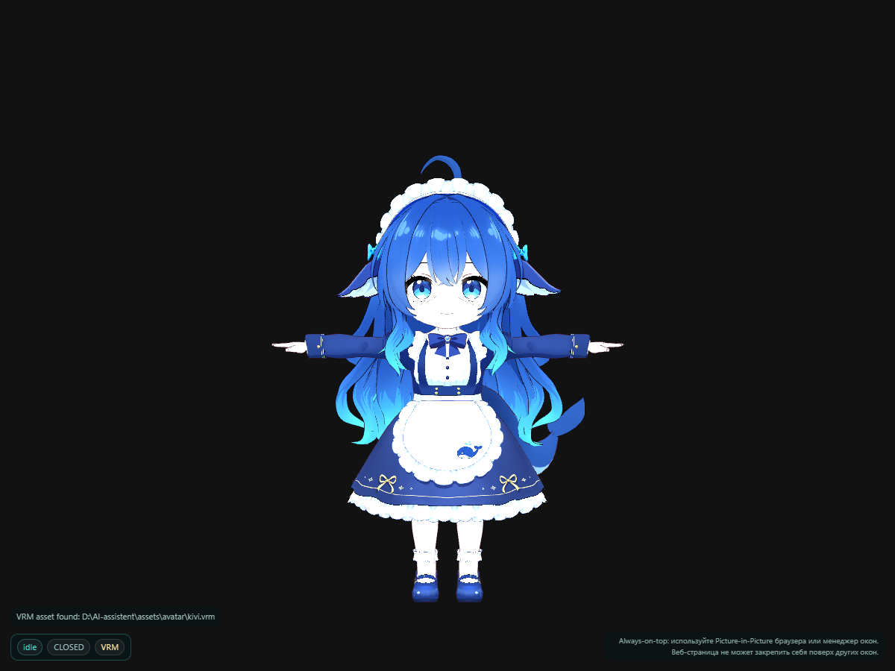

# Kivi 3D VRM: текущий статус

VRM-ассет найден и работает локально:

```text
assets/avatar/kivi.vrm   (~35 МБ, VRM 0.x / glTF 2.0)
```

Проверено 13.11.2026:

- `vrm_status()` → `VRM asset found`;
- страница `web/avatar3d` загружается без интернета;
- three.js и `@pixiv/three-vrm` установлены локально в
  `web/avatar3d/node_modules` (в git не входят);
- камера исправлена: персонаж виден целиком, а не только макушка;
- HUD показывает `VRM`, состояние `idle`, визему `CLOSED`.



## Запуск

```powershell
cd D:\AI-assistent
.venv\Scripts\kivi.exe avatar --port 8766
```

Откроется `http://127.0.0.1:8766/`. Для запуска без браузера:

```powershell
kivi avatar --no-browser
```

## Важно

Модель **Big Fat Blue Fish** от Mzkagami: коммерческое использование и
распространение запрещены. Файл исключён из git (`assets/avatar/*.vrm`) и
используется только локально. Подробнее — [ASSET-LICENSE](ASSET-LICENSE.md).

Осталось для полной M5-приёмки:

- подключить animation mixer (idle/listen/think/talk), сейчас T-pose/idle;
- связать виземы с TTS/UI-аватаром;
- кастомный wake ONNX (текстовый wake через Whisper уже есть).
