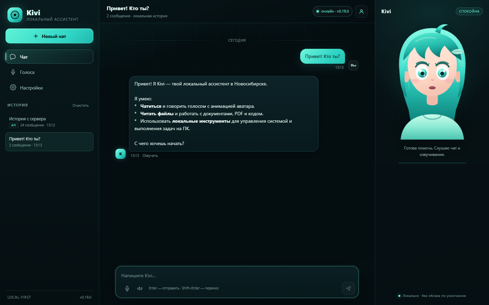
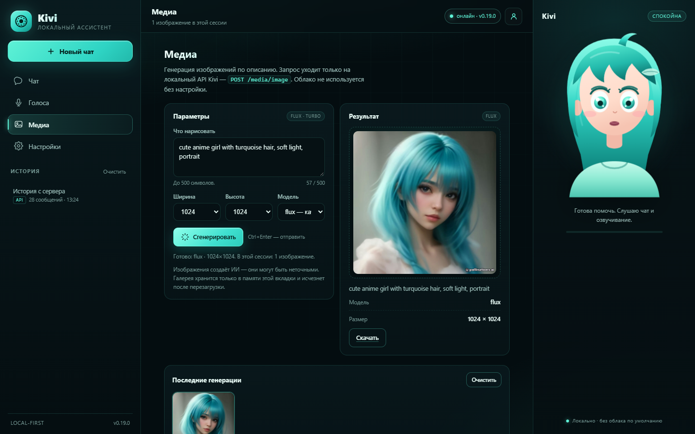
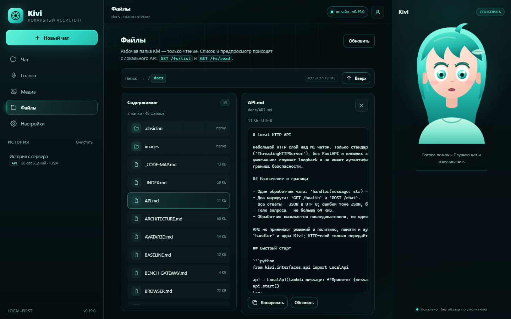
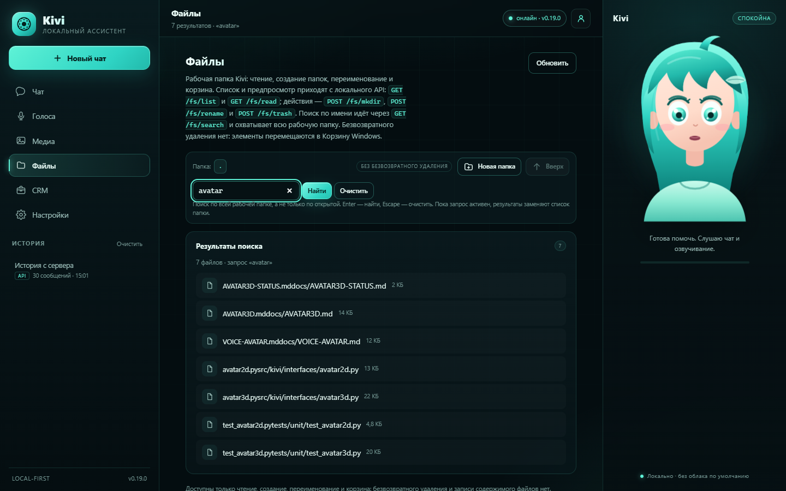
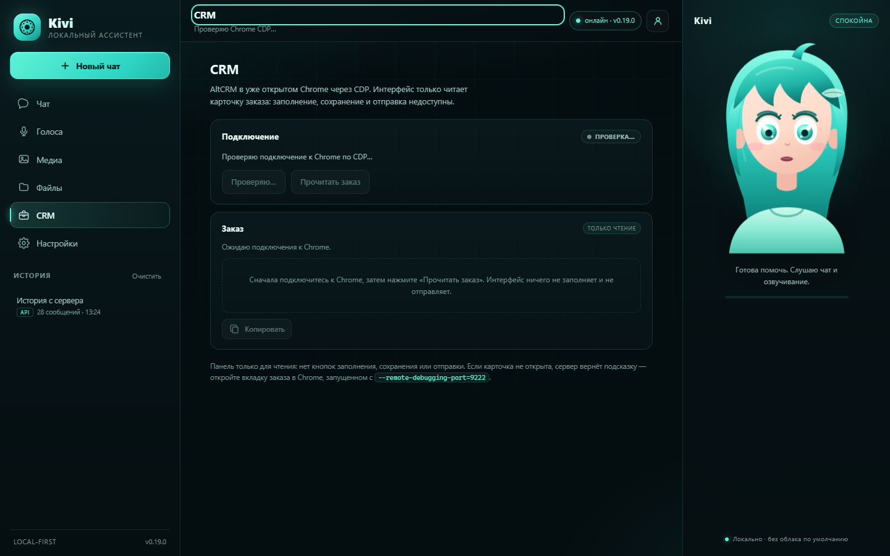
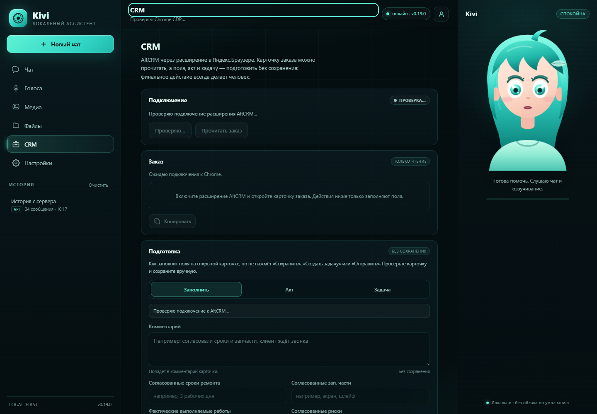
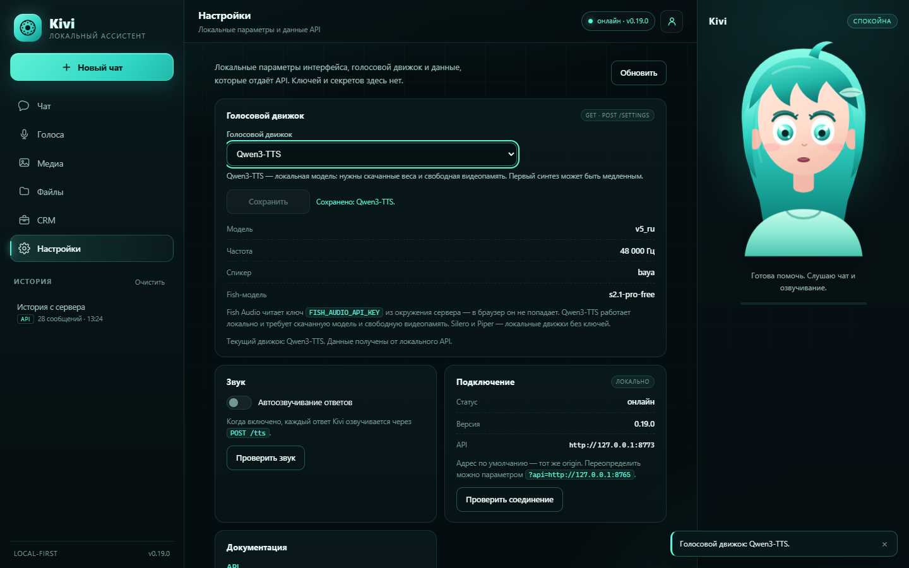

# Kivi UI: полноценный локальный интерфейс

`kivi ui` запускает локальный сервер и открывает интерфейс в браузере:
`http://127.0.0.1:8765`. Это не облако: страница, API и модели остаются на
этом компьютере.















## Запуск без терминала

Дважды щёлкни **`Kivi UI.bat`** в корне проекта. Откроется отдельное окно
приложения (Edge/Chrome `--app`) и иконка Kivi в трее.

Или вручную:

```powershell
cd D:\AI-assistent
.venv\Scripts\kivi.exe ui --app --tray
```

Полезные флаги:

```powershell
kivi ui --port 8765
kivi ui --no-browser
kivi ui --app
kivi ui --tray
kivi ui --model hf.co/Qwen/Qwen3-8B-GGUF:Q4_K_M
kivi ui --whisper-model data/models/faster-whisper-large-v3-turbo
```

## Что умеет интерфейс

- чат с историей (SQLite), новые чаты, очистка;
- **CRM-панель**: статус расширения AltCRM в Яндекс.Браузере, read-only
  карточка, формы `Заполнить / Акт / Задача` без сохранения;
- **файловый обзор**: список workspace, поиск имён, переход по папкам, preview
  текста, копирование, создание папок, переименование и корзина;
- **медиа-панель**: prompt, 512/768/1024, flux/turbo, результат и галерея
  сессии через `/media/image`; видео — `kivi media video`;
- голосовые ответы: кнопка «Озвучить», авто-озвучка, `/tts`;
- **голосовой ввод**: удерживай кнопку микрофона, браузер запишет WAV и
  отправит его в локальный Whisper (`/transcribe`);
- голоса из локальной библиотеки: `kivi voice add/list/use`;
- выбор голосового движка (Fish / Qwen / Silero / Piper) с сохранением;
- текущий провайдер и модель в настройках;
- аватар Kivi с состояниями idle/listening/thinking/speaking;
- проверка звука через WebAudio;
- локальный API: `/health`, `/chat`, `/tts`, `/transcribe`, `/history`,
  `/voices`, `/settings`.

## API

| Метод | Путь | Назначение |
|---|---|---|
| GET | `/` | HTML-интерфейс |
| GET | `/health` | статус и версия |
| POST | `/chat` | `{message}` → `{answer, task_id}` |
| POST | `/tts` | `{text}` → `audio/wav` |
| POST | `/transcribe` | WAV-тело → `{text}` (локальный Whisper) |
| POST | `/media/image` | `{prompt,width,height,model}` → `{image: dataURL}` |
| GET | `/fs/list?path=` | список папки workspace |
| GET | `/fs/search?q=` | поиск имён в workspace |
| GET | `/fs/read?path=` | текст файла workspace (read-only) |
| POST | `/fs/mkdir` | `{path}` — создать папку |
| POST | `/fs/rename` | `{source,destination}` — переименовать |
| POST | `/fs/trash` | `{path,confirm}` — в корзину Windows |
| GET | `/crm/status` | статус Chrome CDP/AltCRM |
| GET | `/crm/read` | read-only карточка заказа |
| GET | `/history?limit=50` | последние сообщения |
| GET | `/voices` | голоса библиотеки |
| POST | `/voices/active` | `{id}` → активный голос |
| GET | `/settings` | провайдер, модель, sample rate |
| POST | `/settings` | `{voice_provider}` → сохранённый движок |

API слушает только loopback и не имеет аутентификации; не выставляй его в
интернет. Текст для `/tts` уходит в выбранный TTS-движок: Fish Audio — в
облако, Qwen/Silero/Piper — локально.

## Ограничения текущего среза

- удаление только в корзину Windows; без корзины/безвозвратного удаления из UI;
- первый голосовой ввод загружает Whisper и может занять несколько секунд;
- браузерный микрофон требует разрешения; при отказе UI покажет причину;
- нет системного трея-уведомления о новых сообщениях;
- нет стриминга Fish Audio: WAV приходит целиком;
- история — последние сообщения, без ветвления диалогов.
